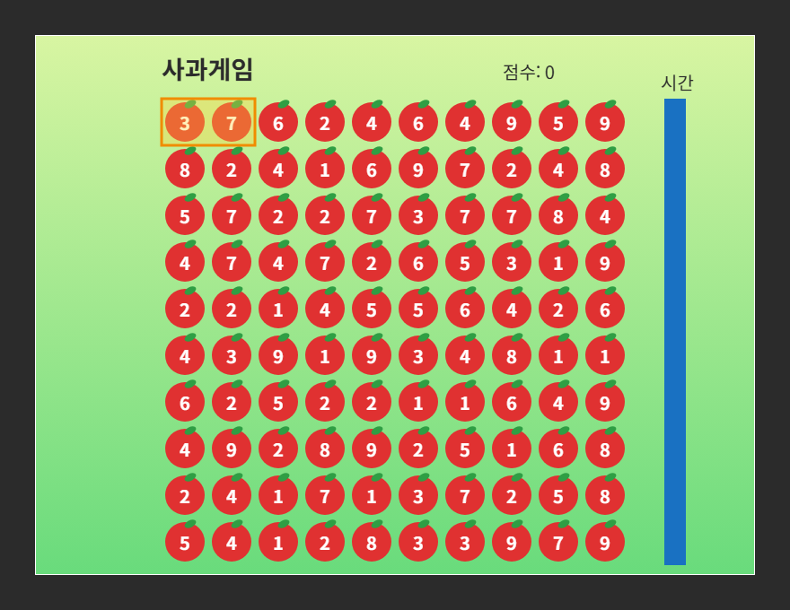

# 게임 기획서

## 1. 제목
사과게임

## 2. 한 줄 설명
"플레이어가 마우스로 드래그하면서 사과를 없애고 점수를 획득하는 게임"

## 3. 플레이어가 하는 일
- 조작: 마우스 (드래그로 사각형 범위를 선택해서 사과 묶기)
- 목표: 합이 10이 되는 묶음을 찾아 없애고 점수를 올린다

## 4. 화면에 있는 것
| 이름 | 생김새 | 역할 |
|---|---|---|
| 사과 | 빨간 원(반지름 22) + 초록 잎, 가운데 흰 숫자 1~9 | 10×10으로 놓임. 묶어서 합이 10이면 사라진다 |
| 선택 상자 | 반투명 노란 사각형 + 주황 테두리 | 지금 묶고 있는 사과를 표시 |
| 점수 | 위쪽 가운데 글씨 "점수: 0" | 없앤 사과 수 |
| 남은 시간 | 오른쪽 세로 파란 막대 | 시간이 지나면 줄어든다 |
| 제목 | 왼쪽 위 굵은 글씨 "사과게임" | 게임 이름 |
| 종료 문구 | 점수와 함께 뜨는 게임 종료 문구 | 끝나면 뜸 |

## 5. 규칙
- 점수가 오르는 조건: 마우스 드래그로 사각형 범위를 선택해서 사과를 지정하고 그 사과들의 총합이 10이면 득점
- 게임이 끝나는 조건: 제한시간이 끝나면 게임 종료
- (있으면) 난이도가 올라가는 방식: 없음

## 6. 화면 스케치

## 7. 만들 순서
- [ ] 4주차: 사과의 배치
- [ ] 5주차: 플레이어의 조작은 변환없이 사과를 지우기 위한 공간만 조작 가능
- [ ] 6주차: 사과를 지우면 점수를 부여하고 짧은 시간 안에 많은 점수를 얻도록 하는 것이 목표
